# Wind Turbine Structural Analyser
A Python desktop application for carrying out structural finite-element analysis of a parametric wind turbine under gravity and wind loading. The application brings turbine geometry generation, shell meshing, CalculiX analysis, post-processing, and result visualisation into a graphical workflow.
Project type: Team academic project
Tested development environment: Windows, Python 3.14.4
External solver: CalculiX (must be installed separately)

# Table of Contents
- Overview
- Key Features
- Screenshots and Demo GIFs
- Technology Stack
- Project Structure
- Requirements
- Installation
- Configure CalculiX
- Run the Application
- Run an Analysis from the Command Line
- Analysis Workflow
- Output Files
- Team and Responsibilities
- Limitations and Engineering Disclaimer
- Acknowledgements
# Overview
The Wind Turbine Structural Analyser is intended to help users build a parametric wind turbine model, prepare it for shell finite-element analysis, apply gravity and wind loading, and inspect the calculated structural response.

The project combines:
1. Geometry generation for the turbine components.
2. Mesh generation using Gmsh, with quadratic S6 shell elements required by the current CalculiX input writer.
3. Structural analysis using CalculiX for gravity and reference-wind load cases.
4. Post-processing to combine analysis results and assess stress-related failure indicators.
5. Visualisation of the model and available stress, strain, displacement, and element-level results through the desktop interface.
The desktop application is built with PySide6 and uses the project’s geometry, solver, and visualisation modules.
# Key Features
- Parametric generation of the default wind turbine geometry.
- Shell-mesh generation through Gmsh.
- Gravity and reference-wind structural analysis through CalculiX.
- Reuse of existing gravity and wind analysis results when the stored result metadata matches the requested configuration.
- Combined stress and strain post-processing for the selected operating wind speed and direction.
- Failure-assessment reporting, including elastic first-yield screening and buckling information when a buckling assessment has been performed.
- Desktop GUI for project setup, solving, and reviewing results.
- 3D result visualisation and element-level result inspection when the required output files are available.
# Screenshots and Demo GIFs
Screenshots and short GIF recordings make it easier for a new user to understand the application before installing it. Store these assets inside the repository under media/ and reference them with relative paths in this README.

---

## Application Screenshots

### 1. Home Page
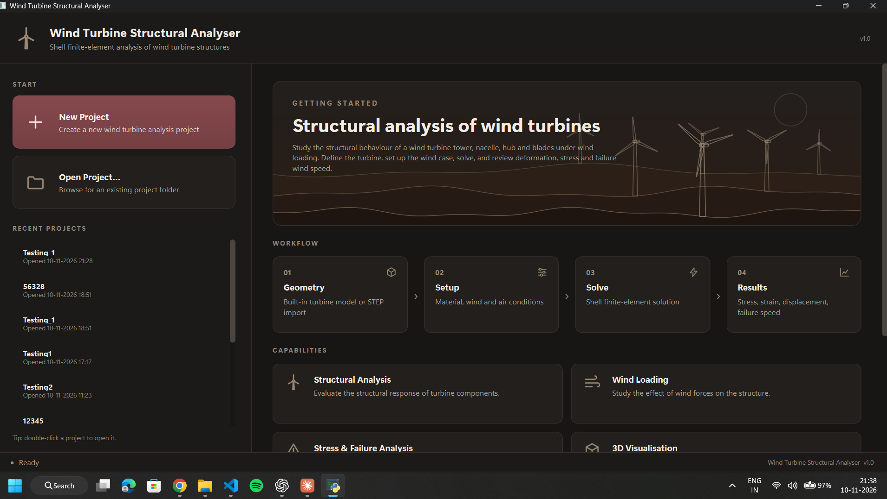

### 2. Project Setup
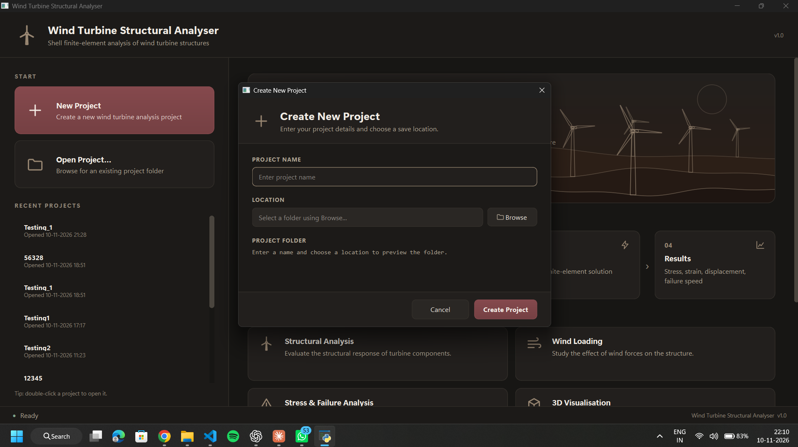

### 3. Geometry Workspace
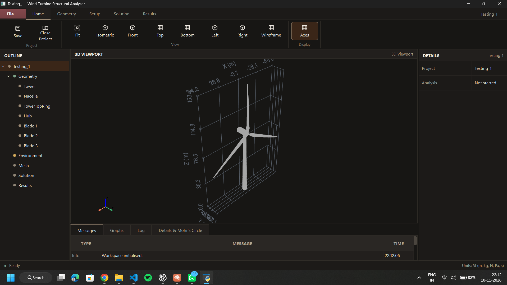

### 4. Analysis Settings
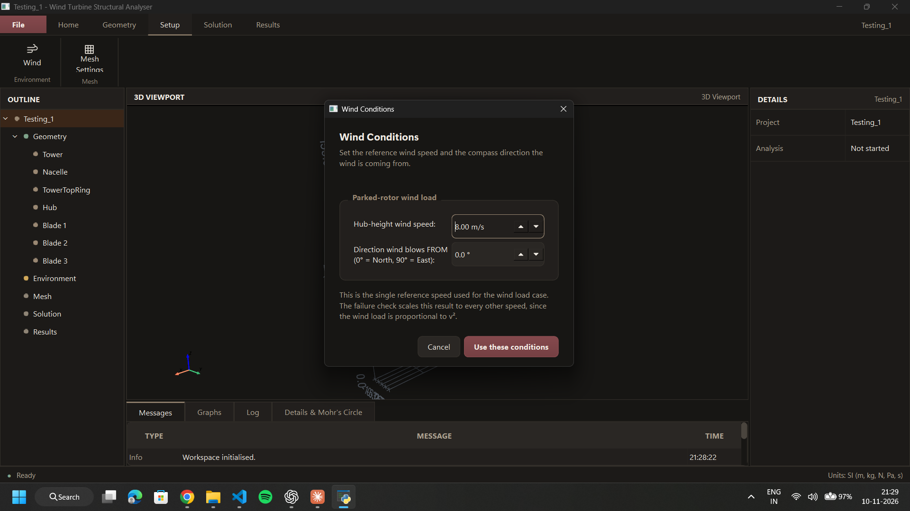

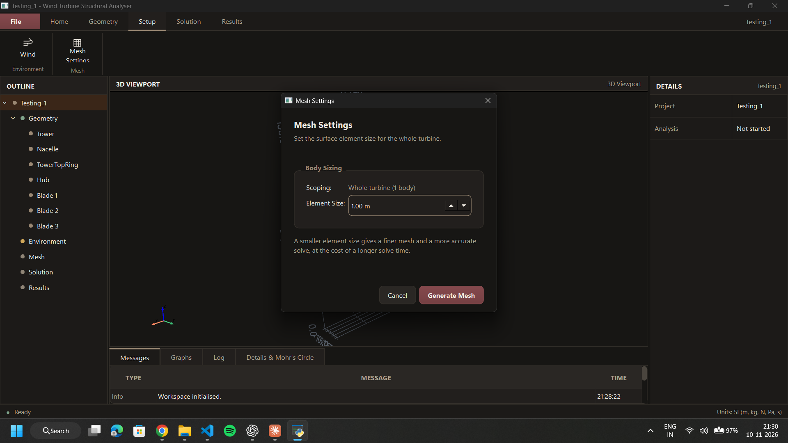

### 5. Structural Analysis Results
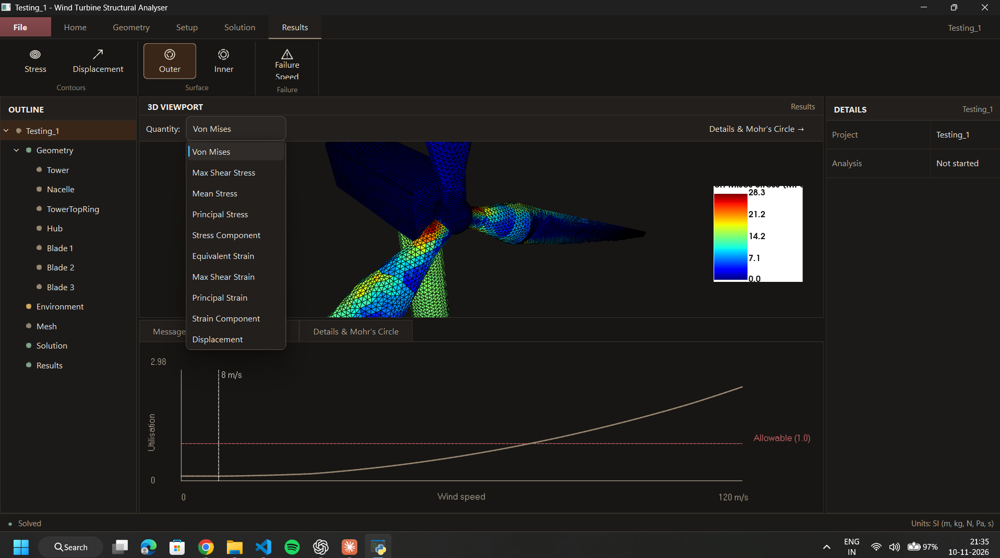

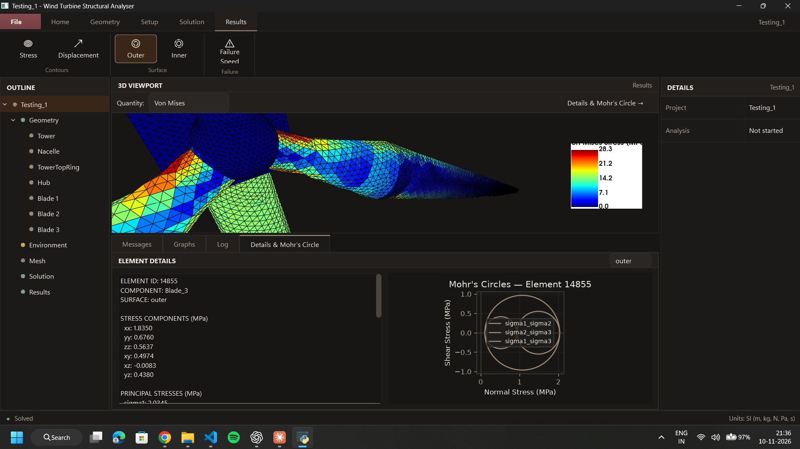

### 6. Element Details
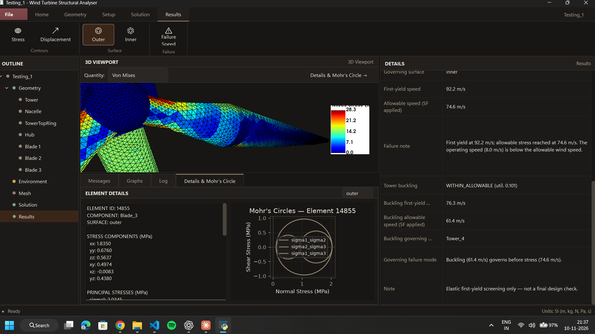

## Application Demonstrations
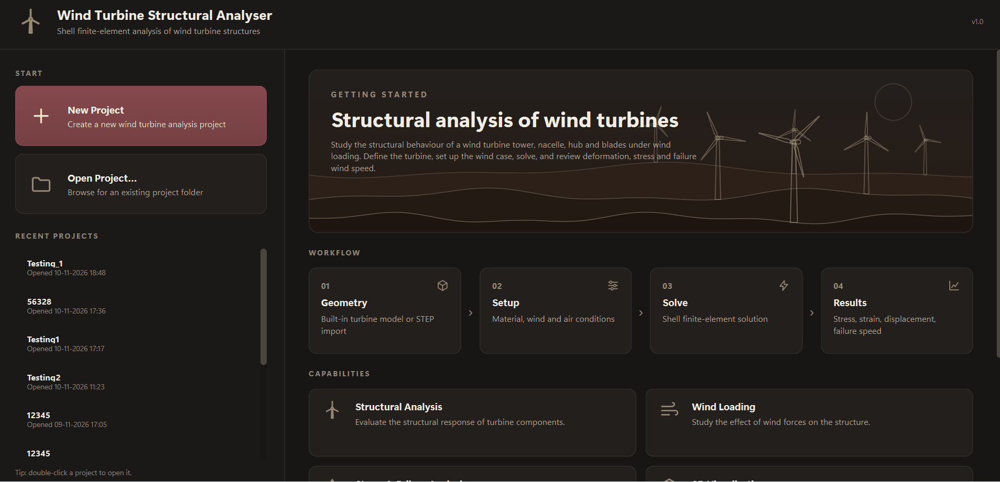 #1

### Additional Demonstrations
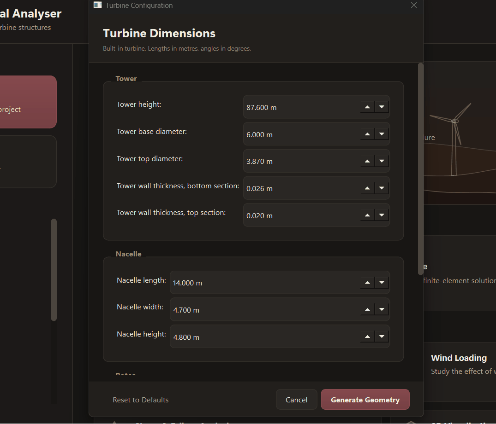 #2

### Running Structural Analysis

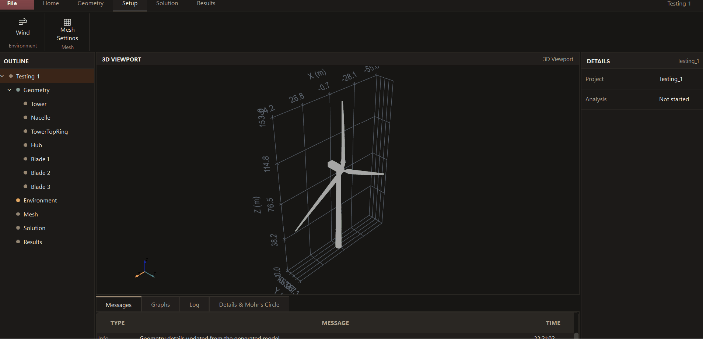 #3

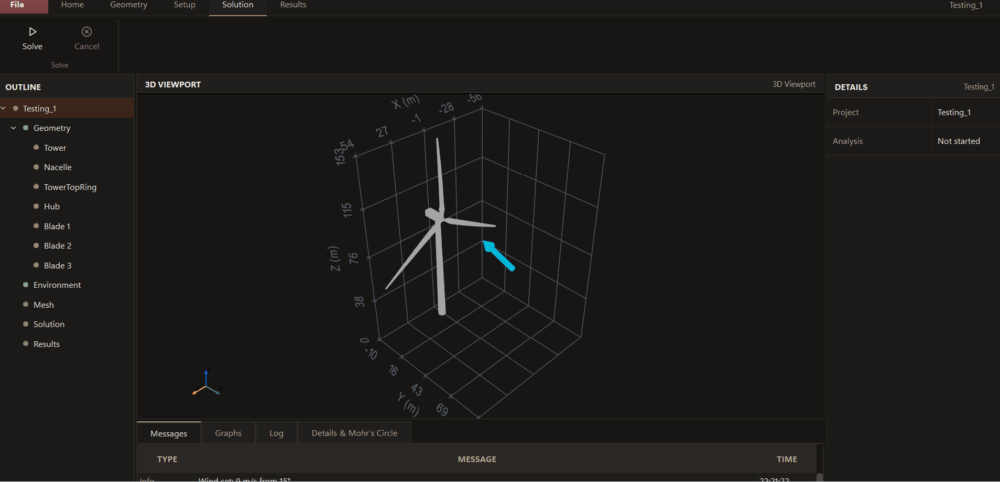 #4

### Exploring Results
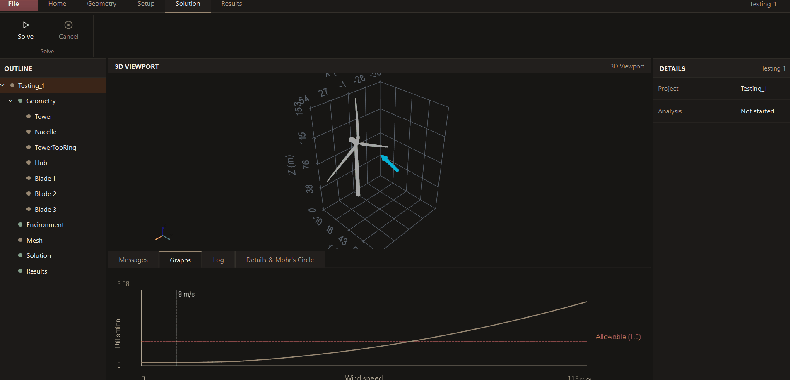#5

# Technology Stack
| Area | Technology |
|---|---|
| Programming language | Python |
| Desktop user interface | PySide6 / Qt |
| Geometry and meshing | Gmsh |
| Finite-element solver | CalculiX (external installation) |
| Numerical computation | NumPy, SciPy |
| 3D visualisation | PyVista, VTK, PyVistaQt |
| Plotting | Matplotlib |
| Tabular/data support | openpyxl |

# Project Structure
The repository is organised into the following main modules:
wind-turbine-structural-analyser/
├── data/                  # Default turbine configuration and reference data
├── geometry/              # Turbine geometry generation
├── gui/                   # PySide6 application and GUI components
├── media/                 # README screenshots and demonstration GIFs
├── out/                   # Generated analysis outputs and cached results
├── solver/                # Meshing, boundary conditions, loads and CalculiX interface
├── visualization/         # Mesh conversion, contours and element result utilities
├── main.py                # Desktop application entry point
├── parameters.py          # Analysis and turbine parameter handling
├── project_manager.py     # Project management utilities
├── contracts.py           # Shared data structures
├── run_analysis.py        # End-to-end command-line analysis workflow
├── run_gravity.py         # Gravity analysis workflow
├── run_winds.py           # Reference-wind analysis workflow
├── StressAndStrain.py     # Combined stress/strain post-processing
├── failure_analysis.py    # Failure assessment calculations and reporting
├── analysis_metadata.py   # Analysis result metadata utilities
├── requirements.txt      # Pinned Python dependencies
├── check_mesh.py          # Mesh checking utility
├── test_mesh.py           # Mesh test entry point
├── test_viewport.py       # Viewport test entry point
├── .gitignore
└── README.md
The out/ directory contains generated solver and post-processing files. A new analysis can generate its own outputs; the committed sample outputs, when present, can also be useful for inspecting an existing run. Do not remove files from out/ without first checking whether the relevant project workflow needs them.
# Requirements
- Windows is the development platform used for the current project setup.
- Python 3.14.4 was used in the development environment from which this README was prepared. Other Python versions have not been confirmed here.
- The Python packages listed in requirements.txt.
- A separate CalculiX installation with the ccx executable available either through PATH, the CCX_PATH environment variable, or the command-line --ccx option.
# Installation
Open PowerShell in the repository root.
1. Create and activate a virtual environment
py -3.14 -m venv .venv
.\.venv\Scripts\Activate.ps1
If PowerShell blocks activation in the current terminal session, run:
Set-ExecutionPolicy -Scope Process -ExecutionPolicy Bypass
.\.venv\Scripts\Activate.ps1
2. Install Python dependencies
python -m pip install --upgrade pip
python -m pip install -r requirements.txt
3. Check the installed packages
python -m pip check
A successful check should report that no broken requirements were found.
# Configure CalculiX
CalculiX is an external solver and is not installed by pip install -r requirements.txt.

After installing or extracting CalculiX, locate its executable (ccx.exe on the Windows setup used for development). Configure the path in the same PowerShell session before launching the application or running an analysis:
$env:CCX_PATH = "C:\path\to\CalculiX\bin\ccx.exe"
Replace the example path with the actual location of your own ccx.exe. Do not copy another user's computer-specific path into the repository.

Alternatively, add the directory containing ccx.exe to your Windows PATH, or pass the executable path directly to the command-line analysis using --ccx.

To check whether the executable is available on PATH:
Get-Command ccx
To check the configured environment variable:
$env:CCX_PATH
Note: Setting Env: Ccx Path in PowerShell applies to that terminal session. Set it again in a new terminal, or configure a persistent user environment variable through Windows settings if required.

# Run the Application
With the virtual environment activated and CalculiX configured, launch the desktop application from the repository root:
python main.py
Use the application’s project workflow to create or open a project, configure the turbine and analysis settings, run the solver, and inspect the available results. The exact files produced by a solve are written to that project’s output directory.
# Run an Analysis from the Command Line
The end-to-end command-line workflow can run or reuse the gravity and reference-wind analyses, combine the results, and write a failure assessment.

Example:
python run_analysis.py --wind-speed 9 --wind-direction 130
The wind direction is the bearing the wind comes from:
| Direction | Bearing |
|---|---:|
| North | 0° |
| East | 90° |
| South | 180° |
| West | 270° |

To specify a CalculiX executable explicitly:
python run_analysis.py --wind-speed 9 --wind-direction 130 --ccx "C:\path\to\ccx.exe"
Useful options can be viewed with:
python run_analysis.py --help
The current command-line interface also provides options for the turbine configuration, mesh sizing and refinement, output directory, yield strength, and safety factor. Check --help for the defaults and accepted values in the version you are using.
# Analysis Workflow
A typical analysis follows this sequence:
1. Prepare a project: create or open a project in the desktop application.
2. Configure the turbine: choose the available turbine configuration and dimensions.
3. Set analysis conditions: provide the operating wind speed and wind direction, along with the available mesh and analysis settings.
4. Generate the mesh: create the shell analysis mesh used by the solver.
5. Run the solution: execute the gravity and reference-wind CalculiX load cases. Existing results may be reused when their recorded metadata matches the requested configuration.
6. Post-process: combine the relevant solver results and calculate the stress/strain and failure-assessment outputs.
7. Review results: inspect the available contours, assessment summary, and element-level information in the GUI.
# Output Files
The analysis output directory may contain files such as:
| File | Purpose |
|---|---|
| `G.inp`, `W.inp` | CalculiX input decks for gravity and reference-wind cases |
| `G.dat`, `G.frd`, `W.dat`, `W.frd` | CalculiX solver result files |
| `full_mesh.pkl`, `wind_mesh.pkl` | Saved analysis meshes |
| `res_G.pkl`, `res_W.pkl` | Saved gravity and reference-wind result objects |
| `stress_strain_results.npz` | Combined stress/strain post-processing data |
| `failure_assessment.json` | Failure-assessment summary and related data |
The GUI's results viewer expects full_mesh.pkl and stress_strain_results.npz in the selected project's out/ directory. Gravity and wind result pickles are also used when displacement data is available. A solve should be completed before trying to inspect results for a project that does not yet contain these files.
# Team and Responsibilities
Replace the name placeholders with the actual names of all team members before submission.
| Team member | Main contribution |
|---|---|
| **Bhukya.Sai kumar** | Turbine geometry, parameterisation, and geometry/mesh generation contributions |
| **Aryan Pandurang ghadage** | Boundary conditions, loading, CalculiX integration, solver workflow, and structural connectivity utilities |
| **Bandari Santhan**  | Stress/strain post-processing, failure assessment, and result visualisation |
| **Beera Charan teja**  | Desktop GUI, application architecture, integration of team modules, and project workflow |
Update these descriptions to match the final responsibilities agreed by the team.
# Limitations and Engineering Disclaimer
- The failure assessment includes elastic first-yield screening. It is an academic analysis aid and is not a certified turbine design verification.
- Buckling information is reported when a buckling assessment has actually been performed; otherwise the application may indicate that it was not checked.
- The results depend on the selected geometry, mesh, material properties, boundary conditions, loads, and solver configuration. These inputs should be reviewed before interpreting an analysis.
- The displacement combination/scaling convention should be independently validated before relying on absolute displacement values for engineering decisions.
- A successful software run does not by itself establish that the model, assumptions, boundary conditions, or material data are suitable for a real turbine design.
Use the software for learning and project evaluation. Do not use its output as the sole basis for safety-critical or certified engineering decisions.
# Acknowledgements
The default turbine reference data draws on the NREL 5-MW reference turbine material, including NREL report NREL/TP-500-38060. Additional model dimensions and assumptions should be identified as project assumptions where applicable.
Maintained by: Aryan Pandurang ghadage/Mechanics of solids?/IIT Hyderabad

Repository: https://github.com/aryanghadage457-code/wind-turbine-structural-analyser